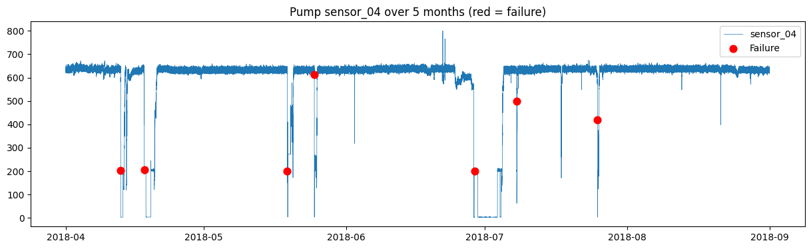
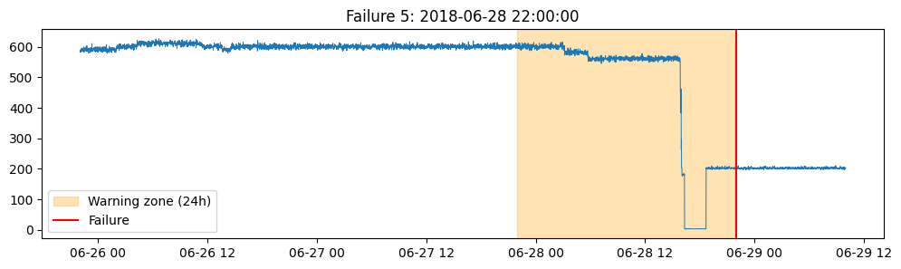
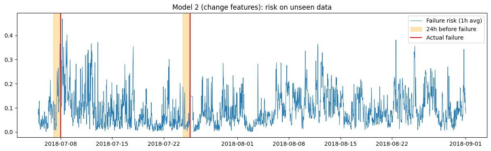

# Predictive Maintenance Proof of Concept: Industrial Pump Failures

**An ML early-warning system for unplanned pump failures, framed as a pre-sales
scenario for a simulated UAE water utility.**

> Independent student project. Not affiliated with any company.
> All business figures are illustrative assumptions.

---

## The business problem
*Gulf Water Co.* (fictional) runs 120 critical pumps for water treatment and
desalination. Pumps fail without warning, which causes downtime, emergency
repairs and service disruption.

The real sensor data used here shows the scale of the problem: **7 unplanned
failures in about 5 months, causing about 10 days of downtime** on a single pump system.

**Goal:** warn operators before a pump fails, while keeping false alarms low
enough that maintenance teams trust and act on the alerts.

## Data
- **Source:** Pump Sensor Data, Kaggle: https://www.kaggle.com/code/shawkyelgendy/pump-sensor-data-timeseriesanalysis
- 220,320 one-minute readings (April–August 2018), 52 sensors, 7 failures
- Not included in this repo because of file size (124 MB). Download `sensor.csv`
  and upload it when the notebook asks.

## Approach
1. **Exploratory analysis:** visualised sensors around each failure and found
   faulty sensors (one sensor empty, one stuck at a fixed value for about 10 days).
2. **Warning-zone labelling:** with only 7 failures, the 24 hours before each failure
   were labelled as a "warning zone", which gave about 9,700 training examples.
3. **Data cleaning:** removed repair periods and minutes when the pump had
   already stopped, so the model can't "cheat" by detecting a pump that is already off.
4. **Time-based split:** trained on April–June (5 failures) and tested on
   July–August (2 failures, unseen). This avoids leakage from random splitting.
5. **Feature engineering:** each sensor's deviation from its own 24-hour
   baseline, plus short-term signal noise (100 features).
6. **Alarm logic:** risk threshold, minimum hold time and a grace period after
   repairs, to cut false alarms.

## Results (unseen test period, 59 days)

| Model | Failures caught | Warning time | False-alarm days |
|---|---|---|---|
| Model 1: raw sensor values | 0 of 2 | – | – |
| Model 2: change features | 1 of 2 | ~3 h | 13 |
| **Model 2 + alarm logic (threshold 0.3, 1 h hold)** | **1 of 2** | **~2 h** | **4** |

### Key findings
- **Accuracy is misleading.** Model 1 scored 97% accuracy but caught zero
  failures, because it predicted "normal" every time. Models like this should be
  judged on failures caught and false alarms, not on accuracy.
- **Looking at many sensors together beats one sensor.** One test failure looked sudden
  on the main sensor but was flagged about 2 hours early by changes across other
  sensors (top features: noise in sensors 34 and 13, deviation in sensors 00 and 36).
- **Catching every failure isn't the best setting.** A lower threshold caught both
  failures but raised false alarms on 20 of 59 days, and one catch was only
  24 minutes early. Too many false alarms make operators ignore alerts.
- **Not every failure is predictable.** Some failures are sudden, so predictive
  maintenance reduces unplanned failures but doesn't eliminate them.

## Limitations
- Only 2 failures in the test period, so results are a proof of concept, not
  a statistically proven detection rate.
- The alarm threshold was chosen using the test period, so results are somewhat
  optimistic. With more data, it should be tuned on a separate validation period.
- Data comes from a single pump system. A real deployment would need a pilot on
  the customer's own SCADA and maintenance data.

## Next steps
- [ ] ROI business case: savings, payback and sensitivity analysis (in progress)
- [ ] Interactive dashboard showing pump risk ranking and business value
- [ ] Anomaly-detection approach (trained on normal behaviour only)
- [ ] Customer-style pitch deck and pilot rollout plan

## How to run
1. Open the notebook in Google Colab: https://colab.research.google.com/drive/1JP7UCFwimw_7XzLyiC0UJn49K7ZjDJP_?usp=sharing
2. Download `sensor.csv` from the Kaggle link above
3. Run all cells and upload the file when asked

**Tools:** Python, pandas, scikit-learn (Random Forest), matplotlib, Google Colab
